<!--
Profile README for haider-dev-coder
Place this file in a public repository named exactly: haider-dev-coder
Keep dark.svg and light.svg in the same repository root.
-->

<picture>
  <source media="(prefers-color-scheme: dark)" srcset="./dark.svg">
  <source media="(prefers-color-scheme: light)" srcset="./light.svg">
  
</picture>

<h1 align="center">Hi, I'm Haider Fareed 👋</h1>

  <strong>Full Stack Developer · AI/ML Engineer · Software Builder</strong>

  I build practical web applications and AI-powered systems — from full-stack business platforms to retrieval-augmented assistants and mobile computer-vision projects.

  <a href="https://haider-fareed.vercel.app/">Portfolio</a> ·
  <a href="https://www.linkedin.com/in/haider-fareed/">LinkedIn</a> ·
  <a href="https://github.com/haider-dev-coder">GitHub</a>

---

## What I Work On

- **Full-stack applications:** responsive React interfaces, TypeScript, Node.js APIs, and relational databases.
- **AI engineering:** LLM-powered assistants, retrieval-augmented generation (RAG), tool-connected agents, and NLP workflows.
- **Computer vision & mobile:** Android applications that connect camera-based experiences with machine-learning inference.
- **Product-minded engineering:** clear interfaces, useful workflows, maintainable architecture, and integrations that solve real problems.

## Featured Projects

### 🤖 [AI Sales Agent](https://github.com/haider-dev-coder/AI-Sales-Agent)
A website-grounded AI sales assistant that crawls business websites, retrieves relevant knowledge for conversations, helps qualify leads, and provides an operator dashboard.

**Tech:** React, TypeScript, Vite, FastAPI, RAG, embeddings, PostgreSQL/pgvector, Docker.

### 🧭 [Guide Nest](https://github.com/haider-dev-coder/Guide-Nest)
An Android accessibility project that uses a camera and a Python object-detection backend to identify nearby objects, estimate distance, and provide spoken guidance.

**Tech:** Java, Android, CameraX, OkHttp, FastAPI, Python, YOLO.

### 🗂️ [CRM System](https://github.com/haider-dev-coder/crm-system)
A full-stack customer relationship management application for organizing leads, customers, properties, and business workflows.

**Tech:** React, TypeScript, Node.js, PostgreSQL, Drizzle ORM.

### 🧠 [AI Life Coach & Habit Tracker](https://github.com/haider-dev-coder/ai-life-coach-agent)
An AI-assisted habit and reflection tool designed to track habits, analyze mood with NLP, and provide personalized coaching. It also includes Google Calendar scheduling integration.

**Tech:** Python, LangChain, Gemini, Streamlit, NLP.

### 🌐 [Portfolio Website](https://haider-fareed.vercel.app/)
My personal portfolio for presenting projects and software development work.

---

## Engineering Stack

  <strong>Frontend</strong> 
  
  
  
  
  

  <strong>Backend & Data</strong> 
  
  
  
  
  
  

  <strong>AI / ML</strong> 
  
  
  
  

  <strong>Mobile & Tools</strong> 
  
  
  
  

## Currently Building & Exploring

- Developing **Metx**, a social mobile app using React Native and Expo.
- Improving full-stack architecture, API integration, and authentication flows.
- Exploring practical applications of LLMs, RAG pipelines, AI agents, and computer vision.

## Let's Connect

I'm interested in software engineering opportunities, AI-focused projects, and collaborations where thoughtful engineering can make a useful product.

- **Portfolio:** https://haider-fareed.vercel.app/
- **LinkedIn:** https://www.linkedin.com/in/haider-fareed/
- **GitHub:** https://github.com/haider-dev-coder
- **Email:** haiderfareed27@gmail.com

---

  <i>Build useful things. Keep learning. Improve with every iteration.</i>

